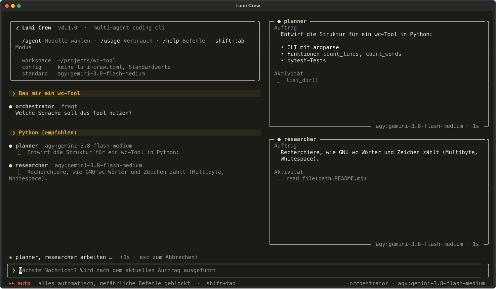
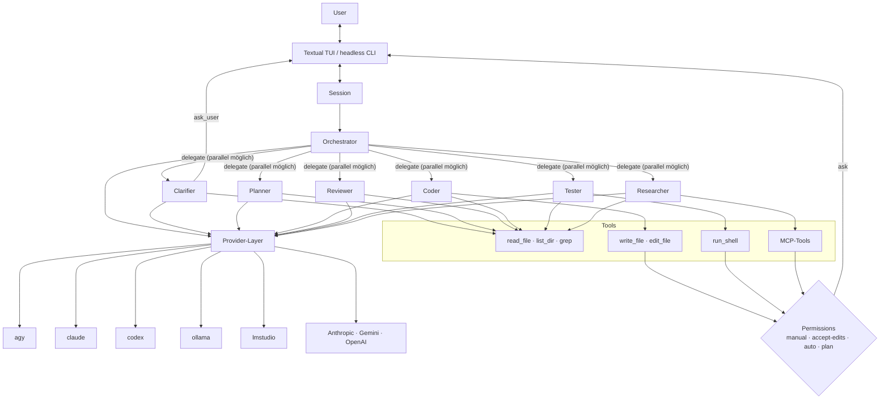

<p align="center">
  
</p>

<h1 align="center">Lumi Crew</h1>

<p align="center">
  Eine Multi-Agent-Coding-CLI im Stil von Claude Code: ein Team spezialisierter KI-Agenten in deinem Terminal.<br>
  <a href="https://github.com/OhneKommentar/lumi-crew/releases"></a>
  <a href="https://github.com/OhneKommentar/lumi-crew/actions/workflows/ci.yml"></a>
</p>

Ein **Orchestrator** entscheidet dynamisch, welcher Spezialist als Nächstes dran ist. Er klärt den Auftrag mit
Gegenfragen, plant, lässt Code schreiben, reviewen und testen und recherchiert bei Bedarf über MCP im Web. Unabhängige
Aufgaben laufen parallel. Jeder Agent bekommt rechts ein eigenes Live-Fenster.



## Installation

```bash
brew install ohnekommentar/tap/lumi-crew
lumi-crew setup        # fehlende CLIs installieren, Login starten, API-Keys hinterlegen
```

Alternativ ohne Homebrew (Python ≥ 3.11):

```bash
uv tool install git+https://github.com/OhneKommentar/lumi-crew@v0.2.0
```

Lumi Crew bringt selbst kein Modell mit. Es braucht mindestens einen dieser Zugänge:

| Provider | Voraussetzung | Tool-Calling |
|---|---|---|
| `agy` | [Antigravity](https://antigravity.google)-CLI, eingeloggt | JSON-Text-Protokoll |
| `codex` | Codex-CLI, eingeloggt (`codex exec`, Sandbox read-only) | JSON-Text-Protokoll |
| `ollama`, `lmstudio` | lokaler Server (`localhost:11434` bzw. `:1234`) | nativ |
| `anthropic` | `ANTHROPIC_API_KEY` oder `ant auth login` | nativ |
| `gemini` | `GEMINI_API_KEY` | nativ |
| `openai`, eigene | API-Key bzw. `base_url` in `lumi-crew.toml` | nativ |

`lumi-crew providers` zeigt, was auf deinem Rechner gerade nutzbar ist. Fehlt etwas, hilft **`lumi-crew setup`**
oder in der TUI direkt `/agent`: Ist eine CLI nicht installiert, bietet Lumi Crew nach Rückfrage die offizielle
Installation an (`brew install --cask codex`, `brew install ollama`, …). Danach startet der offizielle
Login (`codex login`). Für die Claude-API fragt Lumi Crew den Key verdeckt ab und speichert ihn
im **macOS-Schlüsselbund**. Ohne deine Bestätigung wird nichts installiert. Die CLI-Provider laufen als **reine
Text-LLMs**: in einem leeren Temp-Ordner und ohne eigene Tools. Den Workspace fassen ausschließlich die Tools von
Lumi Crew an, und zwar mit Permission-Prüfung. Logins werden nie ausgelesen, Lumi Crew ruft nur die offiziellen CLIs auf.

## Nutzung

```bash
lumi-crew                        # TUI im aktuellen Ordner
lumi-crew -w ~/projekt --mode plan
lumi-crew -c                     # letzten Chat in diesem Ordner fortsetzen
lumi-crew --resume               # gespeicherten Chat auswählen
lumi-crew chats -a               # alle gespeicherten Chats
lumi-crew -p "Bau X" --mode auto # headless, ein Auftrag (wird auch gespeichert)
lumi-crew --model codex          # alle Agenten auf ein Modell, nur für diesen Lauf
lumi-crew providers              # Provider + welcher Agent welches Modell nutzt
```

### In der TUI

| | |
|---|---|
| `/` | Befehle mit Autocomplete (↑↓, Tab, Enter) |
| `/agent` | Agent → Provider (agy, codex, claude, ollama, lmstudio) → Modell. Listen kommen **live** aus den CLIs/Servern. Die Wahl wird gespeichert. |
| `/usage` | CLI wählen → Verbrauch dieser Session (Aufrufe, Tokens, Kosten) plus Abo/Limits, soweit die CLI sie verrät |
| `/resume` · `/new` | frühere Chats fortsetzen · neuen Chat beginnen |
| `/mode` · Shift+Tab | Modus: manual · accept-edits · auto · plan |
| `/agents` · `/providers` · `/mcp` | Übersichten |
| `/model reset` | gespeicherte Modellwahl löschen |
| ↑ / ↓ | Verlauf. Im leeren Feld holt ↑ eine wartende Nachricht zum Bearbeiten zurück |
| Esc · Ctrl+C | abbrechen · beenden |

- **Rückfragen** kommen immer als Auswahl mit Vorschlägen und „✎ Eigene Antwort schreiben…“.
- **Freigaben** (manual/accept-edits) erscheinen inline mit Diff bzw. Befehl: `y` ja · `a` immer · `n`/Esc nein.
- **Usage-Limit:** Läuft ein Modell ins Limit, schlägt Lumi Crew erreichbare Alternativen vor. Der Agent macht danach
  mit seinem Verlauf weiter.
- **Nachrichten während eines Laufs** landen in einer Warteschlange und laufen danach automatisch.

### Modi

| Modus | Dateien schreiben | Shell | MCP |
|---|---|---|---|
| **manual** | fragt (mit Diff) | fragt | fragt |
| **accept-edits** | automatisch | fragt | automatisch |
| **auto** | automatisch | automatisch, gefährliche Befehle geblockt | automatisch |
| **plan** | ✗ | ✗ | automatisch, danach Auswahl, in welchem Modus umgesetzt wird |

Alle Pfade sind auf den Workspace begrenzt, Symlinks eingeschlossen.

## Konfiguration

Optional als `lumi-crew.toml` im Projektordner oder in `~/.config/lumi-crew/`. Vorlage: [`lumi-crew.example.toml`](lumi-crew.example.toml).
Modelle pro Agent, eigene Provider (z. B. OpenRouter), MCP-Server für den Researcher und Limits wie maximale
Review-Runden.

Gespeichert wird in `~/.config/lumi-crew/`: `state.json` enthält die Modellwahl aus `/agent`, `chats/` alle Chats.

## Architektur



| Agent | Tools | Ergebnis |
|---|---|---|
| orchestrator | `delegate`, `ask_user`, lesen | Abschlussbericht |
| clarifier | `ask_user`, lesen | Spec (Ziel, Anforderungen, Annahmen, Akzeptanzkriterien) |
| planner | lesen, `grep` | Dateien, Schritte, Teststrategie |
| coder | lesen, `write_file`, `edit_file` | geänderte Dateien |
| reviewer | lesen | `APPROVED` / `CHANGES_REQUESTED` |
| tester | lesen, `run_shell` | `PASS` / `FAIL` + Output |
| researcher | lesen, MCP-Tools | Zusammenfassung + Quellen |

Harte Grenzen (`max_steps`, `max_delegations`, `max_review_rounds`) verhindern endlose Schleifen.

## Entwicklung

```bash
git clone https://github.com/OhneKommentar/lumi-crew && cd lumi-crew
uv venv --python 3.12 .venv && uv pip install --python .venv/bin/python -e '.[dev]'
.venv/bin/python -m pytest -q
bin/lumi-crew                    # Dev-Starter aus dem Checkout
```

### Versionen & Releases

Lumi Crew folgt [Semantic Versioning](https://semver.org/lang/de/). Jede Version ist ein Git-Tag `vX.Y.Z` mit
GitHub-Release, die Änderungen stehen im [CHANGELOG](CHANGELOG.md). Neues Release:

1. Abschnitt `## [X.Y.Z]` im `CHANGELOG.md` schreiben
2. `scripts/release.sh X.Y.Z`: Tests laufen lassen, Version in `pyproject.toml` setzen, committen, Tag pushen,
   GitHub-Release erstellen und die Homebrew-Formel in
   [OhneKommentar/homebrew-tap](https://github.com/OhneKommentar/homebrew-tap) aktualisieren
3. Nutzer bekommen es mit `brew upgrade lumi-crew`

## Rechtliches & Datenschutz

- Lumi Crew ist ein unabhängiges Projekt und **nicht mit Anthropic, OpenAI oder Google verbunden**. Claude, Codex,
  Gemini und Antigravity sind Marken ihrer jeweiligen Inhaber und werden nur zur Beschreibung der Kompatibilität
  genannt.
- Lumi Crew ruft ausschließlich die **offiziellen CLIs** mit **deinem eigenen Login** auf. Zugangsdaten werden nie
  ausgelesen oder weitergegeben. Für die Nutzung gelten die Bedingungen des jeweiligen Anbieters.
- **Claude** gibt es nur per API-Key (`anthropic`). Zusätzliche Provider lassen sich als lokale **Plugins**
  (`~/.config/lumi-crew/plugins/*.py`, Funktion `register(api)`) einbinden; sie sind nicht Teil von Lumi Crew.
- **Daten:** Deine Prompts und die Inhalte, die die Agenten aus dem Workspace lesen, gehen an den gewählten Anbieter
  (bei Ollama/LM Studio bleibt alles lokal). Lumi Crew selbst sendet keine Daten an eigene Server. Chats und
  Einstellungen liegen nur lokal in `~/.config/lumi-crew/`.

## Lizenz

Keine Open-Source-Lizenz: © OhneKommentar, alle Rechte vorbehalten. Der Code ist öffentlich einsehbar und installierbar,
eine Weiterverwendung braucht aber eine Erlaubnis.
