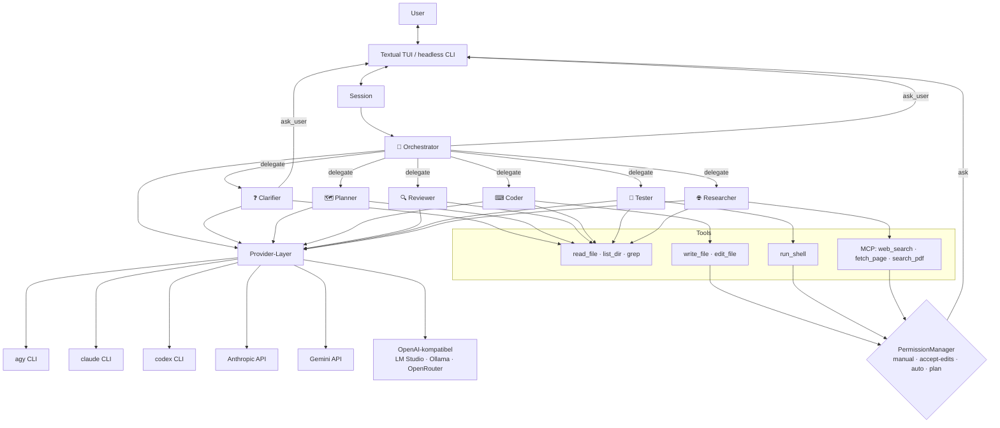

# crew: eine Multi-Agent-Coding-CLI

`crew` ist ein Terminal-Tool im Stil von Claude Code. Im Hintergrund arbeitet ein **Team spezialisierter Agenten**:
Ein **Orchestrator** entscheidet dynamisch, welcher Spezialist als Nächstes dran ist. Er klärt den Auftrag mit
Gegenfragen, plant, lässt Code schreiben, reviewen und testen und recherchiert bei Bedarf über MCP im Web.

```
 ╭──────────────────────────────────────────────╮
 │ ✻ crew  ·  multi-agent coding cli             │
 │   /agent Modelle wählen · /help · shift+tab   │
 ╰──────────────────────────────────────────────╯

 ❯ Bau mir ein wc-Tool in Python                       ← eigene Nachricht (gelb)

 ● planner  agy:gemini-3.8-flash-medium
   ⎿  Plane ein wc-Tool mit pytest-Tests
     ⎿  list_dir()
   ▶ ⎿  ✔ fertig · Antwort anzeigen

 ● coder  codex:gpt-6.2-sol
   ⎿  Implementiere wordcount.py laut Plan
     ⎿  write_file(path=wordcount.py, …)

 ● orchestrator  agy:gemini-3.8-flash-medium
   Fertig! wordcount.py zählt Zeilen, Wörter und Zeichen …

 ✻ tester arbeitet …  (12s · esc zum Abbrechen)
 ╭──────────────────────────────────────────────╮
 │ ❯ Was soll die Crew bauen?  (/ für Befehle)   │
 ╰──────────────────────────────────────────────╯
 ⏵⏵ auto  alles automatisch · shift+tab     orchestrator · agy:gemini-3.8-flash-medium
```

## Architektur



- **Orchestrator-Pattern:** Nur der Orchestrator hat das Tool `delegate(agent, task)`. Jeder Spezialist startet
  mit leerem Kontext und eigenem Tool-Set und bekommt einen vollständigen Auftrag. Sein Ergebnis geht als
  Tool-Result an den Orchestrator zurück, wie bei Subagenten in Claude Code.
- **Harte Grenzen:** `max_steps` pro Agent, `max_delegations` und `max_review_rounds` pro Anfrage. Damit kann die
  Coder⇄Reviewer-Schleife nicht endlos laufen.
- **Rechte nach Rolle:** Nur der Coder schreibt, nur der Tester führt Shell-Befehle aus, nur der Researcher nutzt
  MCP. Reviewer und Planner können nur lesen.

| Agent | Tools | Ergebnis |
|---|---|---|
| 🎯 orchestrator | `delegate`, `ask_user`, lesen | Abschlussbericht |
| ❓ clarifier | `ask_user`, lesen | Spec (Ziel, Anforderungen, Annahmen, Akzeptanzkriterien) |
| 🗺 planner | lesen, `grep` | Dateien + Schritte + Teststrategie |
| ⌨ coder | lesen, `write_file`, `edit_file` | geänderte Dateien |
| 🔍 reviewer | lesen | `APPROVED` / `CHANGES_REQUESTED` + Issues |
| 🧪 tester | lesen, `run_shell` | `PASS` / `FAIL` + Output |
| 🌐 researcher | lesen, MCP-Tools | Zusammenfassung + Quellen |

## Provider: viele Modelle, ein Interface

| Provider | Auth | Tool-Calling |
|---|---|---|
| `agy` | Antigravity-Login (Google) | JSON-Text-Protokoll |
| `claude` | Claude-Code-Login (`claude -p`, Tools aus) | JSON-Text-Protokoll |
| `codex` | Codex-Login (`codex exec`, Sandbox read-only) | JSON-Text-Protokoll |
| `anthropic` | `ANTHROPIC_API_KEY` oder `ant auth login` | nativ |
| `gemini` | `GEMINI_API_KEY` | nativ |
| `openai`, `lmstudio`, `ollama`, eigene | Key per Env / lokal | nativ |

Die CLI-Agenten laufen als **reine Text-LLMs**: in einem leeren Temp-Ordner und ohne eigene Tools. Sie antworten
mit `{"tool": …, "args": …}` oder `{"final": …}` (`crew/providers/text_tools.py`), sodass ausschließlich crews
Tools mit Permission-Prüfung den Workspace anfassen. Abo-Logins werden nie ausgelesen. crew ruft nur die
offiziellen CLIs auf.

Jeder Agent kann ein anderes Modell nutzen (`crew.toml` → `[agents]` oder zur Laufzeit `/model coder codex`).

## Modi

| Modus | Dateien schreiben | Shell | MCP |
|---|---|---|---|
| **manual** | fragt (mit Diff) | fragt | fragt |
| **accept-edits** | automatisch | fragt | automatisch |
| **auto** | automatisch | automatisch, gefährliche Befehle geblockt | automatisch |
| **plan** | ✗ | ✗ | automatisch |

Wechseln mit **Shift+Tab** oder `/mode <name>`. Nach einem Lauf im Plan-Modus fragt crew, in welchem Modus der Plan
umgesetzt werden soll. Im Dialog bedeutet „Immer“, dass das Tool für den Rest der Session erlaubt bleibt. Alle
Pfade sind auf den Workspace begrenzt (inkl. Symlinks).

## Setup & Nutzung

```bash
cd crew
uv venv --python 3.12 .venv && uv pip install --python .venv/bin/python -e '.[dev]'
ln -s "$PWD/bin/crew" ~/.local/bin/crew   # `crew` überall nutzbar (schon eingerichtet)

crew providers                       # welche Provider sind nutzbar?
crew -w ~/mein-projekt               # TUI starten
crew -w ~/mein-projekt --mode plan   # erst nur planen
crew -p "Bau X" --mode auto -w demo  # headless, ein Auftrag
crew --model claude:sonnet           # alle Agenten auf ein Modell
cp crew.example.toml ~/mein-projekt/crew.toml   # Modelle pro Agent, MCP, Limits
```

> `bin/crew` ruft die venv direkt über `PYTHONPATH` auf. Der Grund: macOS/iCloud markiert Dateien in `~/Documents`
> manchmal als „hidden“, und Python ignoriert dann die `.pth`-Datei der Editable-Installation (`.venv/bin/crew` würde
> mit `No module named 'crew'` scheitern).

### Bedienung der TUI

- `/` tippen zeigt alle Befehle mit Autocomplete (↑↓ wählen, Tab vervollständigt, Enter führt aus).
- **`/agent`** zum Durchklicken: Agent wählen (mit aktuellem Modell daneben) → Provider (**agy, codex, claude,
  ollama, lmstudio**, mit Erreichbarkeits-Check) → Modell. Die Modell-Listen werden **live** geholt: `agy models`,
  `codex debug models`, `/v1/models` von Ollama/LM Studio. Für claude gibt es die Aliase opus/sonnet/haiku/fable,
  weil die CLI keinen Listen-Befehl hat und die Aliase immer auf die neueste Version zeigen.
- **↑ / ↓** blättert durch deine letzten Nachrichten und Befehle. Der angefangene Text bleibt als Entwurf erhalten.
- Nachrichten, die du schickst, während die Crew arbeitet, landen in einer **Warteschlange** (`⏸ wartet` über der
  Eingabe) und laufen danach automatisch. Mit **↑** im leeren Eingabefeld holst du die letzte wartende Nachricht
  zurück zum Bearbeiten.
- `/mode` öffnet die Modus-Auswahl, **Shift+Tab** schaltet direkt weiter.
- Freigaben erscheinen inline über der Eingabe, mit Diff/Befehl: `1`/`y` ja · `2`/`a` immer · `3`/`n`/Esc nein.
- Weitere Befehle: `/agents`, `/providers`, `/mcp`, `/model <agent|all> <provider:model>`, `/clear`, `/quit`.
- Tasten: **Shift+Tab** Modus · **Esc** abbrechen · **Ctrl+C** beenden.

### Researcher mit dem MCP-Server aus Lab 4

```bash
labs/.venv/bin/python labs/lab4_mcp/mcp_server.py      # Terminal 1
crew -w demo                                                 # Terminal 2 (crew.toml mit [mcp.lab-websearch])
› Recherchiere, was FastMCP ist, und schreib eine NOTES.md
```

## Demo-Szenarien

1. **Gegenfragen:** `mach mir ein Spiel` → der Clarifier fragt Sprache, Art des Spiels, Steuerung … und dann baut
   die Crew es.
2. **Voller Ablauf:** `--mode auto`, `Baue wordcount.py wie wc, mit pytest-Tests` → Plan → Code → Review → Test (PASS).
3. **Plan-Modus:** Shift+Tab bis `plan` → Auftrag → Plan wird gezeigt → „Accept-Edits“ wählen → Umsetzung.
4. **Gemischte Modelle:** `/model coder codex`, `/model reviewer claude:sonnet` → in der Agenten-Leiste sieht man, wer
   welches Modell nutzt.

## Tests

```bash
pytest -q     # Parser, Permission-Matrix, Pfad-Jail, Delegation, Review-Limit, TUI (Textual Pilot)
```

## Projektstruktur

```
crew/
  cli.py            Einstieg: TUI, headless (-p), `crew providers`
  session.py        Session: Agenten, delegate, ask_user, Limits
  config.py         crew.toml
  permissions.py    Modi, Blockliste, Pfad-Jail
  events.py         Events Agent → UI, UI-Interface
  agents/           Agent-Loop, Rollen, System-Prompts (prompts/*.md)
  providers/        agy · claude · codex (Text-Protokoll), Anthropic · Gemini · OpenAI-kompatibel (nativ)
  tools/            Dateisystem, Shell, MCP-Client
  tui/              Textual-App + Dialoge
tests/
```

## Grenzen (MVP)

- Shell-Befehle laufen im Workspace, sind aber nicht hart gesandboxt (ein `cd /` ist möglich). Deshalb gibt es
  Freigaben in manual/accept-edits und die Blockliste in auto.
- CLI-Provider sind zustandslos. Pro Aufruf wird der Verlauf als Transkript mitgeschickt und bei Bedarf gekürzt.
- Keine Sessions zum Fortsetzen, keine parallelen Agenten.

## Labs (Vorarbeiten)

`labs/` enthält die Labore, auf denen crew aufbaut: **RAG** (`labs/lab_rag/rag_pdf.py`, PDF-Fragen mit FAISS + agy)
und **MCP** (`labs/lab4_mcp/mcp_server.py`, FastMCP-Server mit `web_search`, `fetch_page`, `search_pdf`, den der
Researcher von crew nutzt). Setup und Nutzung: `labs/README.md`.
